# StoneKit

**Detection-aware conformal uncertainty for automated kidney-stone measurement on non-contrast CT**

StoneKit segments kidney stones on non-contrast CT, measures every stone in 3D, and attaches calibrated uncertainty at two levels:

- **per stone**: a size-stratified (Mondrian) conformal interval for volume and for the maximum 3D diameter;
- **per patient**: a *detection-aware* burden interval that propagates false detections, per-stone measurement error and missed stones before a single conformal calibration.

The method was frozen before evaluation and tested once on locked data. A local research workstation exposes the whole pipeline, from CT to calibrated intervals, on new scans.

<p align="center">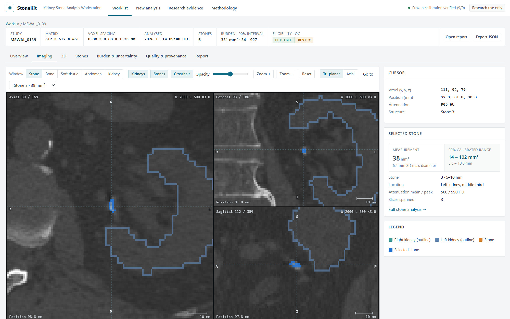</p>
<p align="center"><sub>StoneKit workstation on an external non-contrast scan (MSWAL, CC BY-NC 4.0): linked axial, coronal and sagittal views; the selected stone's measurement beside its 90% calibrated range.</sub></p>

---

## Contents

- [Paper](#paper)
- [Main results](#main-results)
- [How it works](#how-it-works)
- [Research workstation](#research-workstation)
- [Installation](#installation)
- [Usage](#usage)
- [Repository structure](#repository-structure)
- [Datasets and access](#datasets-and-access)
- [Reproducing the reported results](#reproducing-the-reported-results)
- [Citation](#citation)
- [Authors and acknowledgement](#authors-and-acknowledgement)
- [Licence](#licence)

## Paper

> S. K. Kanaparthi, A. R. Kadari, S. P. Surepalli and J. Kolisetty, "Detection-Aware Conformal Uncertainty for Automated Kidney-Stone Measurement on Non-Contrast CT," faculty-revised manuscript, 2026.

The faculty-revised six-page manuscript is the preferred citation. Its public PDF release is pending. The historical repository manuscript remains at [paper/main.tex](paper/main.tex), with Figs. 1–4 and Tables I–III; its plotted figure data are in [paper/figures/](paper/figures/).

**Contributions**
1. **Detection-aware burden interval.** It propagates false-detection probabilities, size-stratified measurement residuals and missed burden, followed by one conformal calibration.
2. **Size-stratified per-stone intervals.** An empirical finding, not a new algorithm: they restore small-stone coverage that global intervals lose.
3. **A descriptive external check** of the unchanged system on an independent dataset.
4. **An open implementation,** including the research workstation.

## Main results

All values are at nominal 90% coverage.

| | Result |
|---|---|
| **Locked test** (53 scans, evaluated once) | Burden interval covered **50/53** scans (Clopper–Pearson 0.843–0.988). Paired median width ratio to a conformalised quantile-regression (CQR) interval **0.573** (95% CI 0.540–0.656). Formal test met |
| **Stone-bearing scans** (post hoc, descriptive) | Width ratio 0.554 (0.535–0.609); narrower in 36 of 42 scans |
| **Robustness** | Ratio below 1 in all three pre-specified sensitivity cohorts (0.622, 0.464, 0.588). Without the 30 mm kidney-distance filter: 0.951 (0.893–1.194), so no width advantage was shown |
| **Small stones** (< 5 mm, 3D diameter) | Size-stratified intervals covered **29/31** stones; a global conformal interval covered 19/31 |
| **External check** (MSWAL, 58 scans; descriptive) | Burden coverage held (56/58), but the width advantage did not transfer (ratio 1.142) and per-stone volume intervals under-covered (0.733) |
| **Physical phantom** (101 stones) | ICC 0.993 alongside a 23.6% median per-stone volume error. 3D maximum diameter bias +0.19 mm, against −1.72 mm for the 2D axial maximum |

<p align="center">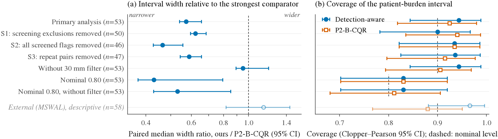</p>
<p align="center"><sub>Repository figure (Fig. 3 in the historical manuscript): width ratio of the detection-aware interval to the CQR comparator (a) and coverage of both (b), for the primary analysis, sensitivity cohorts, filter ablation, nominal-0.80 analyses and the external check.</sub></p>

## How it works

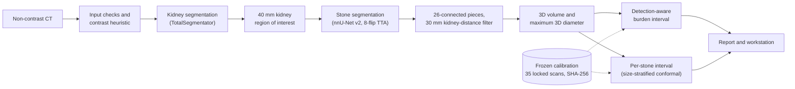

For each scan, the burden interval draws 2,000 Monte Carlo burdens:

$$\tilde B^{(d)} = \sum_j \mathbf{1}\big[u_j^{(d)} \ge \pi_j\big]\,\hat V_j\,e^{\varepsilon_j^{(d)}} + M^{(d)}$$

- π<sub>j</sub> is each piece's false-detection probability;
- ε<sub>j</sub> is a measurement residual from the piece's size band;
- M is a missed-burden draw from the same slice-thickness group.

The 5th–95th percentile interval [L, U] is then widened by one conformal factor *t*, learnt on the calibration scans:

$$\big[\max\{(L+c)e^{-t}-c,\,0\},\ (U+c)e^{t}-c\big],\qquad c = 5\ \text{mm}^3.$$

The primary measurements are the **3D volume** and the **maximum 3D diameter**. The 2D axial diameter is reported only for comparison.

<p align="center">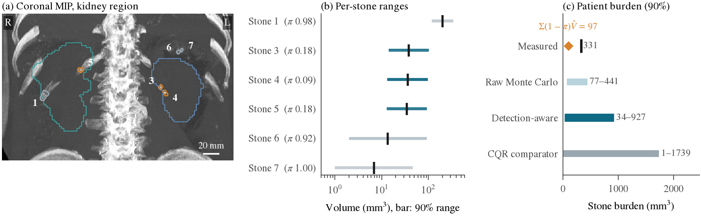</p>
<p align="center"><sub>Repository demonstration (Fig. 5 asset): output for one external non-contrast scan (MSWAL, no annotation used). Three pieces with high false-detection probability π pull the detection-aware interval (34–927 mm³) well below the measured burden (331 mm³).</sub></p>

## Research workstation

`stonekit workstation` opens a local, offline web application at `http://127.0.0.1:8600`. It reads the outputs of the frozen pipeline and applies the frozen, hash-verified calibration. Nothing is refitted.

| | |
|---|---|
| 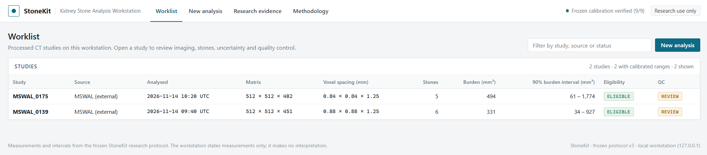 **Worklist**: processed studies with eligibility (non-contrast check), stone count, burden, 90% interval and QC status | 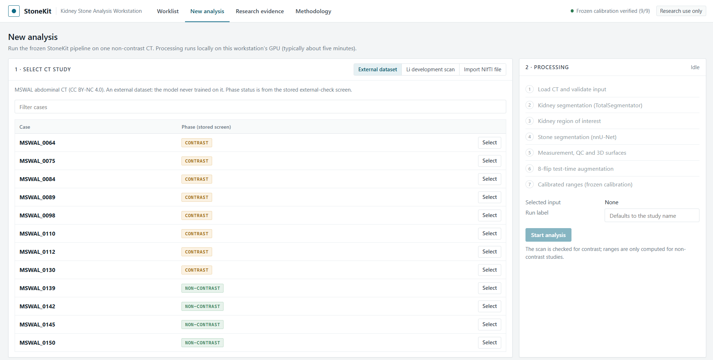 **New analysis**: run the full pipeline on a CT with live progress through each stage |
| 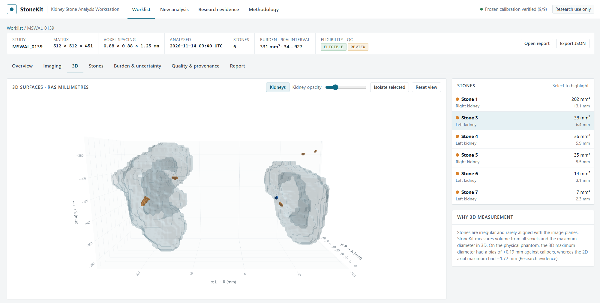 **3D**: kidney and stone surfaces in patient coordinates; isolate a stone | 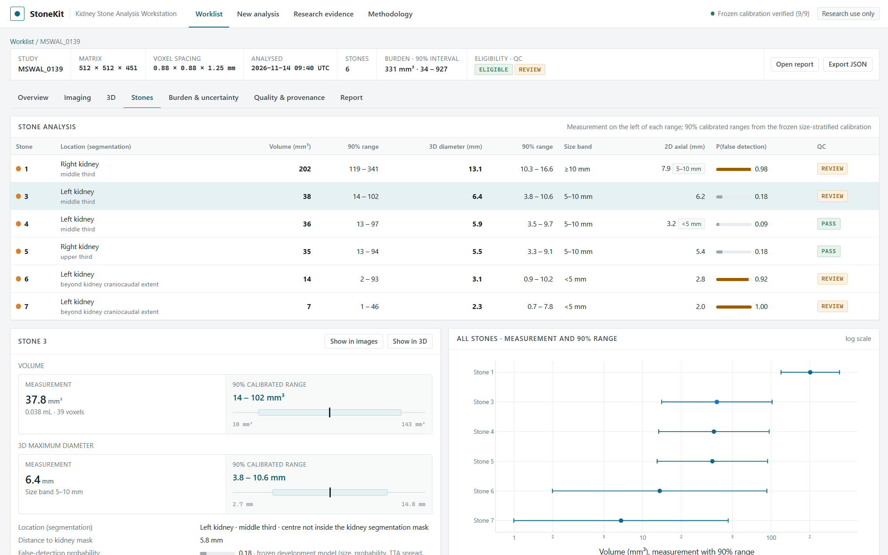 **Stones**: each measurement shown separately from its 90% range, with size band, location from the segmentation, false-detection probability and 2D/3D comparison |
| 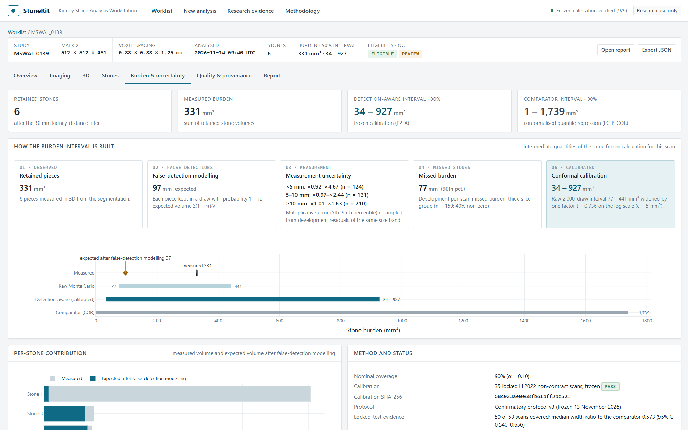 **Burden & uncertainty**: the detection-aware interval built up step by step for the scan, with the CQR comparator | 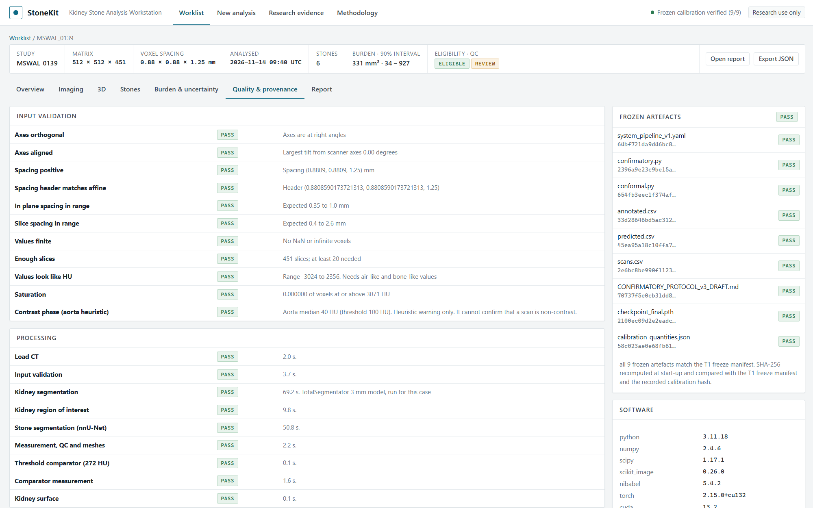 **Quality & provenance**: PASS / REVIEW / WARNING for every check and stage, software versions, SHA-256 of the frozen artefacts |
| 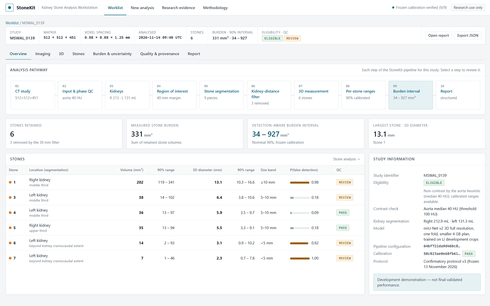 **Overview**: the analysis pathway from CT to report for one study | 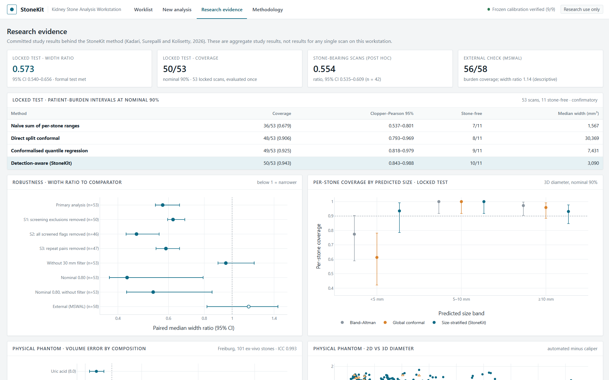 **Research evidence**: the paper's locked-test, robustness, size-band, phantom and external results |

The workstation also produces a structured, print-ready report and a JSON export for each study. See [docs/WORKSTATION.md](docs/WORKSTATION.md) for its architecture, API and verification. All screenshots show external MSWAL scans (CC BY-NC 4.0).

## Installation

```bash
git clone https://github.com/SaiPraneeth9955/stonekit.git
cd stonekit
conda env create -f environment.yml        # Python 3.11, PyTorch, nnU-Net v2, TotalSegmentator
conda activate stonekit
pip install -e .
pytest -rs                                 # tests that need restricted data or model weights are skipped
```

`environment.lock.yml` records the exact versions used in the study, including nnU-Net v2 2.8.1 and TotalSegmentator 2.18.0. A CUDA GPU is needed only for segmentation. The workstation's viewer, the analysis and the figure scripts run on a CPU.

## Usage

```bash
# process one CT end to end: pipeline, 8-flip TTA and calibrated ranges
python scripts/demo_case.py --ct path/to/non_contrast_ct.nii.gz --name my_scan

# open the workstation (http://127.0.0.1:8600)
stonekit workstation

# pipeline only (measurements and report, no ranges)
stonekit run-case --ct path/to/non_contrast_ct.nii.gz
```

**What a new scan needs:**
- **Segmentation:** the trained nnU-Net checkpoint.
- **Calibrated ranges:** also the development out-of-fold tables, which supply the residual, missed-burden and false-detection pools.

Both are derived from the access-controlled Li 2022 data, so neither is distributed (see [Datasets and access](#datasets-and-access)). Without them, the workstation still opens existing outputs. Its provenance view then marks the absent artefacts as NOT AVAILABLE, never as verified.

## Repository structure

| Path | Contents |
|---|---|
| `src/stonekit/` | The Python package: pipeline (`pipeline/`, `measure/`, `seg/`), conformal and burden engine (`uq/`), locked-evaluation gates and analysis (`t1/`, including `case_ranges.py` for single scans), workstation (`workstation/`), evaluation utilities and data loaders |
| `scripts/` | Analysis and figure scripts, including `t1_run.py` (the guarded single-run evaluation), `demo_case.py` (one scan end to end), `make_paper_figures.py` and `make_case_figure.py` |
| `configs/` | Run configurations, including the frozen pipeline configuration `system_pipeline_v1.yaml` |
| `tests/` | Unit, integration and workstation tests |
| `paper/` | Historical repository manuscript, its figures and plotted values, and the reference audit |
| `docs/` | Frozen confirmatory protocol and freeze manifest, results log, data registry, paper audit, workstation documentation, screenshots |
| `results/runs/` | Stored aggregate outputs from the original study |

## Datasets and access

No patient CT data are included in this repository.

| Dataset | Role | Access and licence |
|---|---|---|
| Li et al. 2022: unenhanced abdominal CT with kidney and stone masks | Development (165 scans), calibration (35), locked test (53) | Zenodo [10.5281/zenodo.6042410](https://doi.org/10.5281/zenodo.6042410); access granted by the authors case by case. **Not redistributed** |
| CT-Uroliths-Freiburg: 101 ex-vivo stones | Physical-reference phantom | [10.6084/m9.figshare.21992264](https://doi.org/10.6084/m9.figshare.21992264), CC BY 4.0 |
| MSWAL: abdominal CT with lesion labels | External check (77 stone-bearing scans; 58 non-contrast) | [Hugging Face zhaodongwu/MSWAL](https://huggingface.co/datasets/zhaodongwu/MSWAL), CC BY-NC 4.0. Only derived figures and screenshots of two scans appear here |

**Not included:**
- patient images and masks;
- per-scan or per-stone tables derived from Li 2022 or from MSWAL annotations;
- trained model weights;
- run intermediates;
- machine-specific scripts.

## Reproducing the reported results

The confirmatory evaluation was run once on locked scans, and its outputs are stored and hashed. From this repository you can:

1. **Check the original study results against the stored aggregates.** The numbering below refers to the historical repository manuscript.

   | Paper element | Source |
   |---|---|
   | Table I, Fig. 3, locked-test text | `results/runs/T1_20261113T081425Z/analysis/evaluation.json` |
   | Stone-bearing width ratio (post hoc) | `results/runs/t1_posthoc_width_replay_20261114T081724Z/posthoc_width_replay.json` |
   | Table III, external rows of Fig. 3 | `results/runs/mswal_external_check_20261113T132418Z/external_check.json` |
   | Pre-unlock simulation (Methods) | `results/runs/t1_dry_run_development_20261112T100623Z/summary.json` |
   | Table II, development rows | `results/runs/e8_burden_uncertainty_20261112T085235Z/`, `ablation_nc_development_20261112T104213Z/`, `failure_analysis_development_20261112T110426Z/` |
   | Fig. 2, phantom text | `results/runs/freiburg_r2_r3_20261111T074847Z/`, `rep1_neubauer_replication_20261111T074337Z/` |
   | Repository demonstration (Fig. 5 asset) | `paper/figures/fig5_case_data.csv` (from `scripts/make_case_figure.py`) |

   ```bash
   cd results/runs/T1_20261113T081425Z/analysis && sha256sum -c calibration_quantities.sha256
   ```

2. **Regenerate the repository figure assets for Figs. 1–4.** Run `python scripts/make_paper_figures.py`. Every plotted value is in `paper/figures/*_data.csv`.
3. **Build the historical repository manuscript.** Run `cd paper && latexmk -pdf main.tex`.
4. **Re-run the full study,** after obtaining the datasets:
   - run the pipeline and the development analyses in `scripts/`;
   - run `scripts/t1_run.py`. It refuses to run unless the protocol hash, commit, split, configuration and checkpoint all match the freeze.

## Citation

```bibtex
@unpublished{kanaparthi2026stonekit,
  author = {Kanaparthi, Suresh Kumar and Kadari, Abhijith Reddy and Surepalli, Sai Praneeth and Kolisetty, Jaswanth},
  title  = {Detection-Aware Conformal Uncertainty for Automated Kidney-Stone Measurement on Non-Contrast CT},
  note   = {Faculty-revised six-page manuscript},
  url    = {https://github.com/SaiPraneeth9955/stonekit},
  year   = {2026}
}
```

Machine-readable citation metadata is in [`CITATION.cff`](CITATION.cff). Please also cite the datasets you use.

## Authors and acknowledgement

**Manuscript authors**

1. **Dr. Suresh Kumar Kanaparthi** (corresponding author), sureshkumar.k@srmap.edu.in
2. **Abhijith Reddy Kadari**, abhijithreddy2006@gmail.com
3. **Sai Praneeth Surepalli**, praneethh777@gmail.com
4. **Jaswanth Kolisetty**, kolisettyjaswanth8@gmail.com

All are with the Department of Computer Science and Engineering, SRM University-AP, Amaravati 522 240, Andhra Pradesh, India. This research received no external funding.

**Software authors.** The software citation in [`CITATION.cff`](CITATION.cff) credits Abhijith Reddy Kadari, Sai Praneeth Surepalli and Jaswanth Kolisetty.

**AI assistance.** Claude Code (Anthropic) reviewed the authors' work, suggested revisions, flagged errors and assisted with technical verification. ChatGPT (OpenAI) assisted with faculty-review interpretation, revision planning, assessment of reported statistics and manuscript verification. Codex (OpenAI) assisted with statistical verification, reviewer-requested analyses, LaTeX compilation and revisions to the Abstract, Introduction, Methodology, Results, Limitations and Acknowledgment. The human authors retain responsibility for the research and final manuscript.

## Licence

Code: MIT (see [`LICENSE`](LICENSE)). Datasets keep their own licences and terms. StoneKit is research software accompanying the paper; it is not a medical device.
